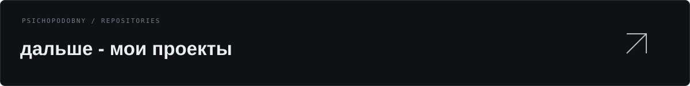

  
   
  Windows 10 / 11 · <a href="https://github.com/psichopodobny/psichopodobny/blob/main/profile-theme/WINDOWS.md">как работает помощник</a> · <a href="https://github.com/psichopodobny/psichopodobny/raw/refs/heads/main/profile-theme/dist/psichopodobny-winter-v1.2.0.zip">ZIP для Chrome / Edge</a>
   
  <a href="https://github.com/psichopodobny/psichopodobny/blob/main/profile-theme/FIREFOX.md">Firefox: ожидается публикация Mozilla ↗</a>

  
    
  
  
Разработка ПО / реверс-инжиниринг / OSINT

   
  <code>C#</code> &nbsp; <code>C++</code> &nbsp; <code>Rust</code> &nbsp; <code>Python</code>
    
  reverse engineering / game tooling / automation / OSINT

  <a href="#проекты">проекты</a> &nbsp; / &nbsp;
  <a href="https://github.com/psichopodobny/psichopodobny/tree/main/profile-theme">кастомный профиль ↗</a> &nbsp; / &nbsp;
  <a href="#инструменты-для-реверса">инструменты</a> &nbsp; / &nbsp;
  <a href="https://github.com/psichopodobny/psichopodobny-and-uikole">psichopodobny and uikole ↗</a>

 

## обо мне

**psichopodobny**, 16 лет. Разрабатываю игровой софт, утилиты и инструменты автоматизации. Основные языки - **C#**, **C++**, **Rust** и **Python**.

Пишу читы для **Minecraft** и **Rust**, создаю сайты, настраиваю серверы и окружение для запуска сервисов. В автоматизации работаю с обработкой данных, файлами и повторяющимися действиями.

Отдельное направление - **реверс-инжиниринг**: анализ бинарей и .NET-сборок, отладка, исследование памяти и логики программ. Также занимаюсь **OSINT**, **GEOINT** и **HUMINT**.

 

## проекты

Избранные разработки. Для приватных репозиториев доступны краткие описания.

<table>
<tr>
<td width="50%" valign="top">

### Vortex-client

<code>PRIVATE</code>

Клиентский проект с закрытыми исходниками.

</td>
<td width="50%" valign="top">

### konspektik

<code>PRIVATE</code> &nbsp; <code>PWA</code> &nbsp; <code>JavaScript</code>

Органайзер для учёбы: расписание, конспекты, формулы, учебники и заметки. Работает офлайн и устанавливается на Android как PWA.

</td>
</tr>
<tr>
<td width="50%" valign="top">

### Probivochka / Fusion OSINT

<code>PRIVATE</code> &nbsp; <code>Python</code> &nbsp; <code>OSINT</code>

Инструменты для OSINT-исследований: сбор и сопоставление информации, графовое представление связей и отчёты по результатам.

</td>
<td width="50%" valign="top">

### [Winter Profile](https://github.com/psichopodobny/psichopodobny/tree/main/profile-theme)

<code>PUBLIC</code> &nbsp; <code>JavaScript</code> &nbsp; <code>CSS</code>

Расширение для оформления любого личного GitHub-профиля: свой фон, рамка, снег и анимация.

</td>
</tr>
<tr>
<td width="50%" valign="top">

### DeadCode

<code>PRIVATE</code> &nbsp; <code>Rust</code>

Чит для Rust. Приватная разработка.

</td>
<td width="50%" valign="top">

### Stealer

<code>PRIVATE</code> &nbsp; <code>Majestic</code>

Утилита для скрытия от проверок на Majestic. Исходники закрыты.

</td>
</tr>
</table>

  <a href="https://github.com/psichopodobny?tab=repositories">публичные репозитории ↗</a>

 

## инструменты для реверса

Подборка для разбора бинарей, .NET-сборок, памяти и форматов файлов.

<table>
<tr>
<td width="50%" valign="top">

### нативный код и отладка

- **[Ghidra](https://github.com/NationalSecurityAgency/ghidra)** - дизассемблирование, декомпиляция и анализ бинарей.
- **[x64dbg](https://x64dbg.com/)** - отладка Windows-программ x86/x64, просмотр исполнения и памяти.

### .NET и C#

- **[dnSpyEx](https://github.com/dnSpyEx/dnSpy)** - просмотр, редактирование и отладка .NET-сборок.
- **[ILSpy](https://github.com/icsharpcode/ILSpy)** - декомпиляция C# и изучение метаданных сборок.

</td>
<td width="50%" valign="top">

### файлы и структуры данных

- **[Detect It Easy](https://github.com/horsicq/Detect-It-Easy)** - определение формата файла и анализ его структуры.
- **[ImHex](https://github.com/WerWolv/ImHex)** - hex-редактор для работы с бинарными данными.

### память и модули

- **[ReClass.NET](https://github.com/ReClassNET/ReClass.NET)** - изучение структур данных в памяти.
- **[Xenos](https://github.com/DarthTon/Xenos)** - DLL-инжектор для экспериментов с загрузкой модулей.

</td>
</tr>
</table>

 

## OSINT

Поиск, проверка и сопоставление открытой информации. Работа с цифровыми следами, происхождением данных и контекстом источников.

Смежные направления исследований - **GEOINT** и **HUMINT**.

<table>
<tr>
<td width="50%" valign="top">

### GEOINT

Геопространственная информация: карты, открытые снимки, особенности местности и привязка материалов к месту.

</td>
<td width="50%" valign="top">

### HUMINT

Информация от людей и работа с человеческими источниками: контекст, оценка сообщений и сопоставление сведений.

</td>
</tr>
</table>

 

## стек

  
  
  
  

  <code>Git</code> &nbsp; <code>GitHub</code> &nbsp; <code>VS Code</code> &nbsp; <code>Visual Studio</code>

 

## совместная разработка

**[uikole](https://github.com/uikoll)** - партнёр по разработке, 16 лет. Работает на **C#**, **C++**, **Rust** и **Python**. Занимается игровым софтом, автоматизацией, сайтами, серверами и исследованиями в области **OSINT / HUMINT**.

Наши общие направления - читы для **Minecraft** и **Rust**, прикладные утилиты и автоматизация. **Реверс-инжиниринг** и **GEOINT** веду со своей стороны.

Общая страница проектов и направлений: **[psichopodobny and uikole](https://github.com/psichopodobny/psichopodobny-and-uikole)**.

  <a href="https://github.com/uikoll">профиль uikole ↗</a>
  &nbsp; / &nbsp;
  <a href="https://github.com/uikoll?tab=repositories">его проекты ↗</a>

 

