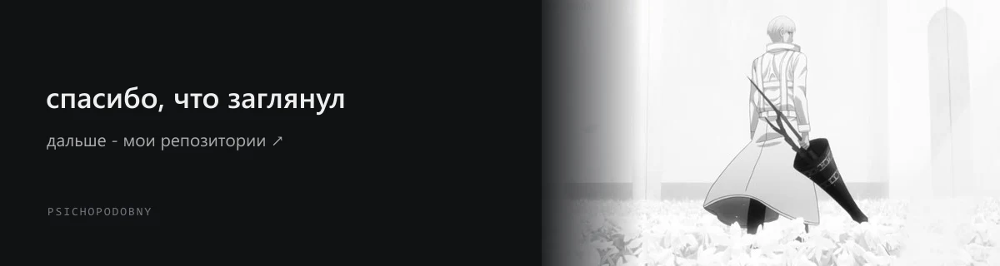

<div align="center">
  
  <br><br>
  
  <p>Я <strong>psichopodobny</strong>. Здесь мои проекты, инструменты и исследования.</p>
  <br>
  <code>C#</code> &nbsp; <code>C++</code> &nbsp; <code>Rust</code> &nbsp; <code>Python</code>
  <br><br>
  <sub>reverse engineering / game tooling / automation / OSINT</sub>
</div>

<p align="center">
  <a href="#проекты">проекты</a> &nbsp; / &nbsp;
  <a href="#инструменты-для-реверса">инструменты</a> &nbsp; / &nbsp;
  <a href="https://github.com/psichopodobny/psichopodobny-and-uikole">psichopodobny and uikole ↗</a>
</p>


<br>

## обо мне

Мне 16, в сети я **psichopodobny**. Пишу читы для **Minecraft** и **Rust**, делаю утилиты для автоматизации, сайты и настраиваю серверы. Люблю реверс, крякинг и задачи, в которых нужно понять, как устроен чужой софт.

```text
alias      psichopodobny
code       C# / C++ / Rust / Python
focus      reverse engineering, game tools, automation
research   OSINT / GEOINT / HUMINT
off-duty   Dota 2 / VALORANT / Rust / GTA 5 RP - Majestic
```

Мне интересно разбирать логику программ, наблюдать за их поведением и собирать собственные инструменты. Могу надолго залипнуть в разбор софта или в задачу, которую хочется автоматизировать. Мне нравится, когда из такого разбора получается что-то, чем можно пользоваться.

<br>

## проекты

Здесь несколько моих разработок. У закрытых проектов публикую название и описание, исходники остаются приватными.

<table>
<tr>
<td width="50%" valign="top">

### Vortex-client

<code>PRIVATE</code>

Клиентский проект. Его исходники и внутреннее устройство пока держу закрытыми.

</td>
<td width="50%" valign="top">

### konspektik

<code>PRIVATE</code> &nbsp; <code>PWA</code> &nbsp; <code>JavaScript</code>

Органайзер для учёбы: расписание, конспекты, формулы, учебники и заметки. Работает офлайн и устанавливается на Android как PWA.

</td>
</tr>
<tr>
<td width="50%" valign="top">

### Probivochka / Fusion OSINT

<code>PRIVATE</code> &nbsp; <code>Python</code> &nbsp; <code>OSINT</code>

Инструменты для OSINT-исследований: сбор и сопоставление информации, графовое представление связей и отчёты по результатам.

</td>
<td width="50%" valign="top">

### [psichopodobny / profile](https://github.com/psichopodobny/psichopodobny)

<code>PUBLIC</code> &nbsp; <code>Markdown</code> &nbsp; <code>SVG</code>

Этот профиль: монохромное оформление с Аримой Кишо, анимированные баннер и приветствие, проекты и инструменты для реверса.

</td>
</tr>
</table>

<p align="center">
  <a href="https://github.com/psichopodobny?tab=repositories">публичные репозитории ↗</a>
</p>

<br>

## инструменты для реверса

Подборка для разбора бинарей, .NET-сборок, памяти и форматов файлов.

<table>
<tr>
<td width="50%" valign="top">

### нативный код и отладка

- **[Ghidra](https://github.com/NationalSecurityAgency/ghidra)** - дизассемблирование, декомпиляция и анализ бинарей.
- **[x64dbg](https://x64dbg.com/)** - отладка Windows-программ x86/x64, просмотр исполнения и памяти.

### .NET и C#

- **[dnSpyEx](https://github.com/dnSpyEx/dnSpy)** - просмотр, редактирование и отладка .NET-сборок.
- **[ILSpy](https://github.com/icsharpcode/ILSpy)** - декомпиляция C# и изучение метаданных сборок.

</td>
<td width="50%" valign="top">

### файлы и структуры данных

- **[Detect It Easy](https://github.com/horsicq/Detect-It-Easy)** - определение формата файла и анализ его структуры.
- **[ImHex](https://github.com/WerWolv/ImHex)** - hex-редактор для работы с бинарными данными.

### память и модули

- **[ReClass.NET](https://github.com/ReClassNET/ReClass.NET)** - изучение структур данных в памяти.
- **[Xenos](https://github.com/DarthTon/Xenos)** - DLL-инжектор для экспериментов с загрузкой модулей.

</td>
</tr>
</table>

<br>

## OSINT

Занимаюсь поиском и проверкой открытой информации: сопоставляю находки, изучаю цифровые следы и смотрю на контекст источников. Важно понять, откуда взялась информация и подтверждается ли она чем-то ещё.

В исследованиях меня также интересуют **GEOINT** и **HUMINT**:

<table>
<tr>
<td width="50%" valign="top">

### GEOINT

Геопространственная информация: карты, открытые снимки, особенности местности и привязка материалов к месту.

</td>
<td width="50%" valign="top">

### HUMINT

Информация от людей и работа с человеческими источниками: контекст, оценка сообщений и сопоставление сведений.

</td>
</tr>
</table>

<br>

## стек

<p align="center">
  
  
  
  
</p>

<p align="center">
  <code>Git</code> &nbsp; <code>GitHub</code> &nbsp; <code>VS Code</code> &nbsp; <code>Visual Studio</code>
</p>

<br>

## вне кода

Играю в **Dota 2**, **VALORANT**, **Rust** и **GTA 5 RP на Majestic**. Иногда хочется просто зайти с напарником в игру и переключиться после кода.

<br>

## uikole / мой напарник по коду

**[uikole](https://github.com/uikoll)** - мой напарник по коду. Нам обоим по **16 лет**. Пишет на **C#**, **C++**, **Rust** и **Python**, делает игровые инструменты, читы для **Minecraft** и **Rust**, утилиты и софт для автоматизации.

Также занимается сайтами, настройкой серверов и исследованиями в области **OSINT** и **HUMINT**. Ему интересны программирование, игровые модификации и новые идеи для собственных проектов. Вне разработки любит музыку и игры.

У нас много общих направлений: разработка софта, игровые проекты, автоматизация и поиск информации. Обсуждаем задачи и собираем инструменты под свои идеи. Мой отдельный фокус - **реверс-инжиниринг** и **GEOINT**.

Нашу общую страницу собрали здесь: **[psichopodobny and uikole](https://github.com/psichopodobny/psichopodobny-and-uikole)**.

<a href="https://github.com/uikoll">
  
</a>

<p align="center">
  <a href="https://github.com/uikoll">профиль uikole ↗</a>
  &nbsp; / &nbsp;
  <a href="https://github.com/uikoll?tab=repositories">его проекты ↗</a>
</p>

<br>

<a href="https://github.com/psichopodobny?tab=repositories">
  
</a>
