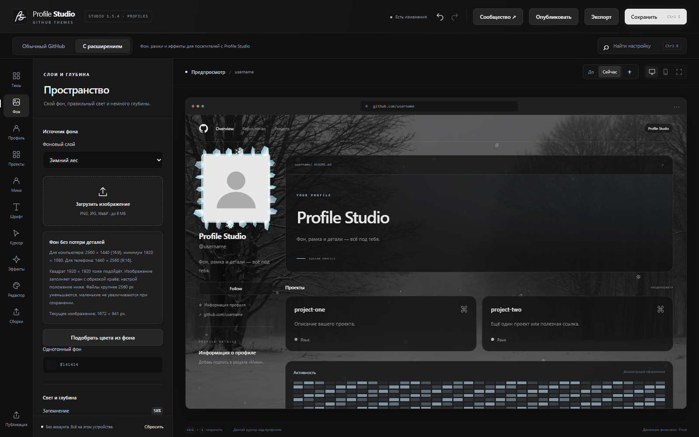

# Profile Studio - GitHub Themes

Редактор GitHub-профилей от **psichopodobny и uikole**.

**Исходники 1.5.4 обновлены 13 ноября 2026.** Два режима оформления, поиск настроек по Ctrl+K, сравнение «До / Сейчас», именованные сборки, плавный фон и независимые палитры профиля и редактора.

[Исходники редактора](profile-theme/studio/extension) · [Запуск и возможности](profile-theme/studio/README.md) · [Сборка и проверки](profile-theme/studio/README-BUILD.md) · [Установить Firefox-версию из Add-ons](https://addons.mozilla.org/firefox/addon/profile-github-/)

## Оформление для всех и для расширения

**Обычный GitHub** собирает README: баннер, текст, значки и проекты. После публикации его видят все посетители GitHub.

**С расширением** меняет всю страницу: фон, отдельный аватар, анимированную рамку, курсор и эффекты. Такое оформление видят пользователи Profile Studio. Владелец может опубликовать тему в своём существующем репозитории, другие — использовать её и делать ремиксы с его разрешения. README для полной темы не требуется.

Настройки сохраняются локально. Расширение не просит GitHub-пароль или токен, не собирает аналитику и не публикует файлы автоматически. Темы владельцев включаются отдельно.

## Что нового

- 20 тем профиля и 20 независимых палитр редактора.
- HEX/RGB, насыщенность/яркость, вертикальная шкала тона и отмена выбора цвета.
- Свой фон и курсор, загрузка шрифта, редактирование проектов и мини-профиля.
- Сравнение вариантов без изменения черновика, поиск настроек и переименование сборок.
- Детализированные эффекты и фон, привязанный к видимой области предпросмотра.
- Проверка владельца опубликованной темы, каталог, импорт/экспорт и ремиксы.

Сборка из исходников: Python 3.10+, затем `python profile-theme/studio/build.py`. Открой `profile-theme/studio/extension/studio.html`. Новая 1.5.4 не отправлялась в Firefox Add-ons; подписанная версия в магазине обновляется отдельно после проверки.

Публичная коллекция включает собственные рамки и загрузку PNG/APNG. Оригинальные анимации Steam из локального сравнения в публичный набор не входят. [Права на материалы](profile-theme/studio/extension/ARTWORK.md) · [Приватность](profile-theme/studio/extension/PRIVACY.md) · [Фактические проверки](profile-theme/studio/test-results/PUBLIC-VERIFICATION.json).

Пакеты EXE/ZIP 1.3 в старых каталогах сохранены как история и не являются версией 1.5.4. [Предыдущие материалы](docs/PERSONAL-PROFILE.md).
