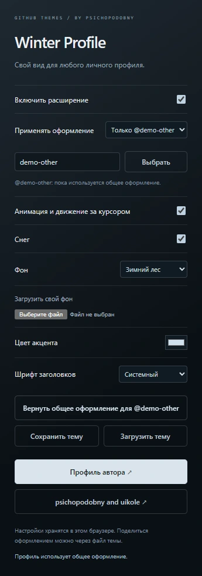

# Winter Profile

**Windows:** [скачать EXE-помощник](https://github.com/psichopodobny/psichopodobny/raw/refs/heads/main/profile-theme/dist/WinterProfile-Setup.exe) · [что он делает и как установить](./WINDOWS.md). Находит браузеры и основной браузер Windows, подготавливает пакеты и открывает нужные страницы. Добавление расширения требует подтверждения браузера; Firefox-сборка пока ждёт подписи Mozilla.

**Firefox:** подготовлена [отдельная сборка для публикации в Mozilla](./FIREFOX.md). Она пока не подписана; обычная установка по кнопке ещё не опубликована. Инструкция ниже относится к Chrome / Edge.

Расширение для оформления **любого личного GitHub-профиля** в Chrome и Edge. Живой фон, рамка аватара, цвет акцента и анимация при прокрутке.

[**Скачать расширение v1.2.0**](https://github.com/psichopodobny/psichopodobny/raw/refs/heads/main/profile-theme/dist/psichopodobny-winter-v1.2.0.zip)


Открой свой профиль или профиль другого человека: имя, аватар, описание, README, репозитории и статистика останутся его собственными. Расширение оформляет существующие элементы GitHub. На страницах **psichopodobny** и **psichopodobny and uikole** также доступна авторская компоновка; половина uikole остаётся цветной.

Настройка действует в браузере установившего расширение человека. Можно выбрать общее оформление или назначить отдельную тему конкретному нику. Другим посетителям настройки автоматически не передаются; поделиться ими можно через файл темы. Аккаунты, содержимое репозиториев и настройки GitHub на сервере не меняются.

## Установка

1. Скачай ZIP по ссылке выше и распакуй его в постоянную папку.
2. Открой `chrome://extensions` в Chrome или `edge://extensions` в Edge.
3. Включи **Режим разработчика / Developer mode**.
4. Нажми **Загрузить распакованное / Load unpacked** и выбери распакованную папку, в которой лежит `manifest.json`.
5. Открой **любой личный GitHub-профиль**. Если страница была открыта до установки, обнови её. Через значок расширения выбери своё оформление.

Это установка из исходников, без публикации в магазине. Порядок загрузки распакованного расширения описан в [документации Chrome](https://developer.chrome.com/docs/extensions/get-started/tutorial/hello-world#load-unpacked).

Не удаляй распакованную папку, пока используешь расширение. ZIP можно удалить после распаковки.

## Управление

- **Движение** - анимация появления, туман, рамка и лёгкое движение фона за курсором.
- **Снег** - отдельный переключатель частиц.
- **Фон** - зимний лес, туманное озеро или своя картинка PNG / JPG / WebP до 4 МБ. Загруженная картинка хранится локально; для фона сохраняется статичный кадр с максимальной стороной 2560 пикселей.
- **Цвет акцента** и **шрифт заголовков** - системный, моноширинный или с засечками.
- **Применять оформление** - общее для всех профилей или отдельное для выбранного ника. Текущий профиль определяется при открытии панели; ник также можно ввести вручную.
- **Сбросить оформление** - сбросить общие настройки. Отдельные темы сохраняются. В режиме выбранного ника кнопка **Вернуть общее оформление** удаляет только настройки этого профиля.
- **Обычный GitHub** - сразу возвращает исходную страницу. Включить оформление снова можно через значок расширения.

Системная настройка уменьшения движения учитывается автоматически. Анимации работают средствами браузера, без покадрового GIF. Частота зависит от экрана, браузера и нагрузки; фиксированные 60 FPS не навязываются.

Тема включается и при переходах между профилями без полной загрузки страницы. Страницы репозиториев, настройки, вход в аккаунт и страницы организаций остаются обычными. Исключение - специально оформленная общая страница автора и uikole.

## Поделиться темой

1. Выбери общее оформление или нужный профиль и настрой его.
2. Нажми **Сохранить тему**. Скачается `winter-profile-theme.json` с оформлением и активной картинкой фона.
3. Передай файл другому человеку. У него в расширении: **Загрузить тему** и выбрать этот JSON.

Файл не содержит ники сохранённых профилей, данные аккаунта и общий переключатель включения. Изображение входит в файл, только если оно выбрано как активный фон. Импорт применяется к выбранному нику или к общему оформлению; настройки других профилей сохраняются.

Тема содержит только поддерживаемые настройки, без произвольных скриптов, CSS и внешних адресов. [Пример готовой темы](./themes/winter-default.json).

<details>
<summary>Панель настройки и обмена темами</summary>

</details>

## Общая страница


Левая половина - монохромная зима и Арима. Правая - оригинальные цвета K-ON! и **uikole**. Оба ника остаются видимыми.

## Доступ и данные

Разрешение `storage` используется для локальных настроек, выбранных фонов и ников, которым пользователь отдельно назначил оформление. Скрипт загружается на `github.com`, чтобы распознавать переходы между личными профилями. Перед включением тема проверяет адрес и наличие элементов личного профиля. Исходное содержимое обычных профилей сохраняется в DOM; оно не заменяется сведениями об авторе расширения. Полная история просмотра не сохраняется.

Нет аналитики, внешних скриптов, запросов к API, доступа к cookies или токенам. Фон не загружается на сервер и не отправляется автору. Иллюстрации, стили и код находятся внутри ZIP. Кнопка **Обычный GitHub** удаляет оформление. Только на двух авторских страницах исходное содержимое временно скрывается, пока показана авторская компоновка.

## Исходники и проверка

Папка [extension](./extension) содержит полный код, который входит в ZIP. Проверки находятся в [tests](./tests).

```sh
npm install
npx playwright install chromium
npm test
```

Проверки запускают расширение в отдельном браузерном профиле на тестовых страницах, без входа в настоящий аккаунт. Проверяются адреса, сохранность чужого содержимого, загрузка ресурсов, переключатели, свой фон, цвет, шрифт, отдельные темы, экспорт/импорт, отклонение неподдерживаемых файлов, сброс, восстановление исходного вида, переходы без перезагрузки, мобильная компоновка и уменьшение движения. Дополнительно проверена загрузка на четырёх публичных страницах GitHub: двух авторских и двух обычных личных профилях. Предпросмотры выше показывают авторские страницы с включённым расширением.

Для обновления замени содержимое распакованной папки новой версией и нажми кнопку обновления на карточке расширения. Для удаления используй **Удалить / Remove** на странице расширений.

Если уже установлена версия 1.0, обнови её папку. Две версии одновременно включать не нужно.

Код распространяется по [MIT](./LICENSE). Иллюстрации принадлежат их правообладателям и не входят в лицензию на код. Источники перечислены в [ARTWORK.md](./ARTWORK.md).
