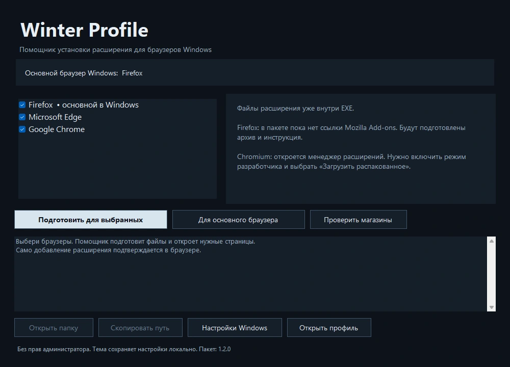

# Winter Profile для Windows

[**Скачать Windows-помощник (.exe)**](https://github.com/psichopodobny/psichopodobny/raw/refs/heads/main/profile-theme/dist/WinterProfile-Setup.exe)

Один файл с пакетами расширения внутри. Подходит для Windows 10 / 11 с .NET Framework 4.8. Права администратора не нужны.

## Как пользоваться

1. Запусти `WinterProfile-Setup.exe`.
2. Оставь отмеченными нужные браузеры и нажми **Подготовить для выбранных**. Кнопка **Для основного браузера** использует выбор Windows.
3. Заверши добавление в открытом браузере. Для браузеров без опубликованной ссылки помощник подготовит файлы и покажет нужную инструкцию.

Поддерживается поиск Firefox, Chrome, Edge, Brave, Opera, Vivaldi, Яндекс Браузера и ряда совместимых вариантов. Определяются браузеры, зарегистрированные в Windows или установленные в стандартные папки текущего пользователя / системы. Профили и учётные записи других пользователей Windows не изменяются.

## Что уже делает автоматически

- Находит браузеры и определяет основной по настройкам Windows.
- Подготавливает встроенный пакет, проверяя его SHA-256.
- Открывает нужную страницу в каждом выбранном браузере.
- Показывает папку с файлами. Путь можно скопировать отдельной кнопкой.
- Если уже подготовленные файлы изменены, оставляет их и создаёт отдельную папку.

Пакеты сохраняются в `%LOCALAPPDATA%\WinterProfile\BrowserSetup`. Не удаляй подготовленную папку, пока используешь распакованное Chromium-расширение.

## Текущее состояние установки

**Firefox:** подписанная ссылка Mozilla Add-ons пока не указана. Помощник сохранит готовый архив для отправки в Mozilla и откроет [страницу Firefox-сборки](./FIREFOX.md). Неподписанный архив не выдаётся за установленное расширение. Для обычной установки Firefox требует [подпись Mozilla](https://extensionworkshop.com/documentation/publish/signing-and-distribution-overview/).

Архив для публикации нужен автору один раз. После публикации обычным пользователям достаточно страницы магазина; собственный аккаунт разработчика им не нужен.

**Chrome / Edge / другие Chromium:** пока нет ссылки магазина, помощник распакует расширение и откроет менеджер дополнений. В браузере нужно выбрать режим разработчика, **Загрузить распакованное** и подготовленную папку. Для обычной установки упакованного расширения Chrome на личном Windows-компьютере нужна [публикация в Chrome Web Store](https://developer.chrome.com/docs/extensions/how-to/distribute).

После публикации ссылки магазинов добавляются в [browser-installation.json](./browser-installation.json). Помощник сможет открывать официальную страницу установки без пересборки EXE. Браузер всё равно показывает своё подтверждение добавления.

## Основной браузер Windows

Кнопка **Настройки Windows** открывает стандартную страницу выбора приложений по умолчанию. Помощник сам не меняет браузер по умолчанию. После возврата в его окно список и отметка основного браузера обновляются.

## Данные и подпись

Список установленных браузеров не отправляется на сервер. По сети запрашивается только публичный файл со ссылками магазинов на GitHub. При отсутствии сети используются встроенные данные и пакеты. Изменения браузерных разрешений и отключение проверки подписей не выполняются.

**Сам EXE пока без цифровой подписи издателя.** Полные исходники открыты. Контрольные суммы файлов находятся в [SHA256SUMS.txt](./dist/SHA256SUMS.txt).

## Проверка и исходники

[Исходники помощника](./windows-helper) и [отчёт проверок](./windows-helper/VERIFICATION.json). Проверено определение браузеров и основного браузера Windows, распаковка, целостность пакетов, сохранность изменённых файлов, обработка путей и выбор сценария установки. В ходе автоматических проверок браузеры не запускались и ассоциации Windows не менялись. Интерфейс проверен через отдельный режим отрисовки.

Собрать из исходников на Windows можно через `windows-helper/build.ps1`; нужны исходники, встроенные ZIP-пакеты из папки dist и системный компилятор .NET Framework. Запуск сборки не устанавливает расширения.
