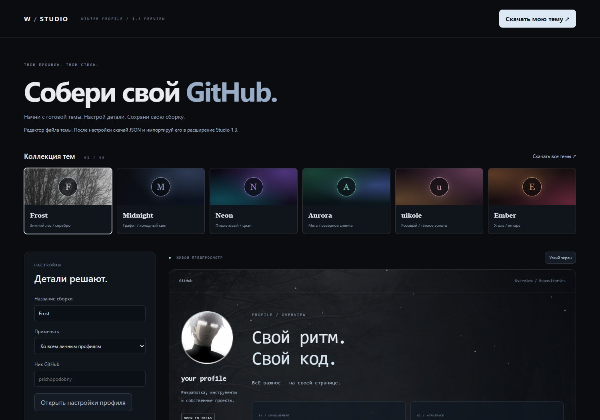

# Winter Profile Studio

Полный редактор оформления GitHub и шесть готовых сборок. Отдельная предварительная версия **1.3.0**. Текущие файлы **1.2.0** для Mozilla остались без изменений.

[Скачать EXE с редактором](https://github.com/psichopodobny/psichopodobny/raw/refs/heads/main/profile-theme/studio/dist/WinterProfile-Studio-Preview.exe) · [Скачать все темы](https://github.com/psichopodobny/psichopodobny/raw/refs/heads/main/profile-theme/studio/dist/winter-theme-collection-v1.3.0.zip) · [Chrome / Edge ZIP](https://github.com/psichopodobny/psichopodobny/raw/refs/heads/main/profile-theme/studio/dist/psichopodobny-winter-v1.3.0.zip)

## Коллекция

- **[Frost](packs/frost.json)** - зимний лес, серебристый свет, моноширинный шрифт и снег.
- **[Midnight](packs/midnight.json)** - графит, холодные акценты и медленная световая орбита.
- **[Neon](packs/neon.json)** - фиолетовый и циан, двухцветная анимированная рамка.
- **[Aurora](packs/aurora.json)** - мятный свет, синие оттенки и плавное движение фона.
- **[uikole](packs/uikole.json)** - розовый, тёплое золото, классическая типографика и мягкая пульсация.
- **[Ember](packs/ember.json)** - угольный фон, янтарь и тёплый свет по краям.

Набор меняет фон, палитру, шрифт, форму и анимацию рамки. Личный аватар и текст при переключении сборки сохраняются. Все цвета можно выбрать вручную.

## Редактор

В расширении открой **«Studio / сборки тем»**. Настройки показываются в живом предпросмотре. Кнопка **«Сохранить оформление»** применяет их к открытым профилям.

Можно выбрать готовый шрифт или загрузить TTF, OTF, WOFF, WOFF2 до 2 МБ. Фон и аватар: PNG, JPG, WebP до 4 МБ. Картинки сохраняются локально в WebP с качеством 96%, без увеличения разрешения; предел стороны 2560 px для фона и 1600 px для аватара. Есть затемнение, размытие, снег, движение за курсором, пять режимов рамки, два цвета и длительность цикла 3-30 секунд.

Для имени, описания, заголовка и своего текста сначала введи ник и открой **настройки конкретного профиля**. Изменения видны в браузере с расширением. Они не меняют учётную запись, репозиторий или публичный README. На других страницах остаются их собственные данные. Для сброса к оригиналу оставь поле пустым или нажми «Сбросить».

**«Скачать мою тему»** сохраняет JSON. По умолчанию в нём только оформление. Для передачи аватара и личного текста включи соответствующий переключатель. Темы Studio используют формат v2: нужен Studio 1.3 или новее. Старые темы формата v1 импортируются.

Кнопка «Узкий экран» проверяет компактный вид. Отключение движения и системная настройка уменьшения анимации останавливают эффекты.

## Windows

EXE содержит редактор и файлы расширения. Кнопка **«Редактор тем»** открывает локальную страницу в основном браузере Windows. Переключатель **«Открыть редактор после подготовки»** включён по умолчанию.

Локальная страница работает как конструктор файла: настрой тему, скачай JSON, затем импортируй его в установленное расширение Studio. Прямое сохранение в расширение доступно в редакторе, открытом из самого расширения. EXE не устанавливает шрифты в Windows и не меняет браузер по умолчанию. У этой предварительной сборки EXE нет подписи издателя.

Для Chrome / Edge помощник готовит папку и открывает менеджер расширений. Включи режим разработчика и выбери «Загрузить распакованное». Добавление подтверждается в браузере.

## Firefox

Studio 1.3 пока **не подписан Mozilla** и не опубликован в магазине. Подготовленный [Firefox ZIP](https://github.com/psichopodobny/psichopodobny/raw/refs/heads/main/profile-theme/studio/dist/psichopodobny-winter-firefox-v1.3.0-unsigned.zip) предназначен для следующей отправки на проверку, а не для обычной постоянной установки. [Архив исходников 1.3](https://github.com/psichopodobny/psichopodobny/raw/refs/heads/main/profile-theme/studio/dist/psichopodobny-winter-firefox-v1.3.0-source.zip) приложен отдельно. Загрузку версии 1.2 можно завершить её прежними файлами.

## Приватность и проверка

Настройки, картинки, шрифты и черновики остаются в браузере. Общий лимит сохранённого оформления - 8 МБ, до 50 отдельных профилей. Нет аналитики, фоновых загрузок файлов или сервера с пользовательскими данными. Собственная тема передаётся только когда ты сам скачиваешь и отправляешь файл. EXE может проверить публичный JSON со ссылками на официальные магазины; тема и личные данные туда не отправляются.

Проверено в изолированном Chromium: шесть сборок, настоящая загрузка TTF, аватар, сохранение по профилям, экспорт и импорт, возврат оригинального содержимого, мобильный вид и уменьшение анимации. На публичном GitHub проверены шрифт при действующей CSP и сохранение цветной половины uikole. Firefox-пакет прошёл addons-linter; проверка в работающем Firefox ещё не выполнена. [Отчёт](VERIFICATION.json) · [Воспроизведение сборки](README-BUILD.md).
